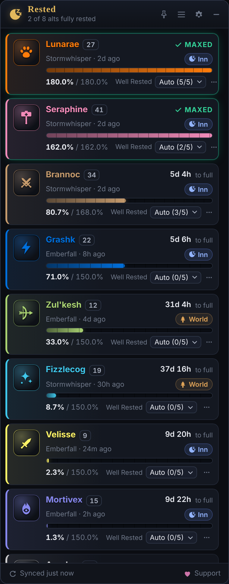
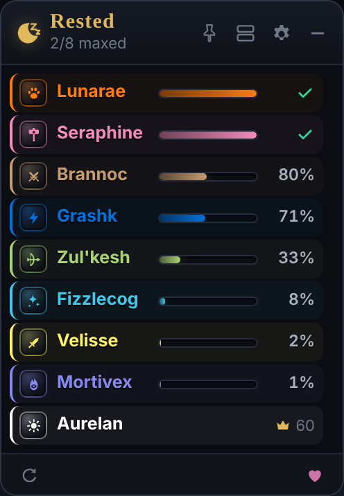
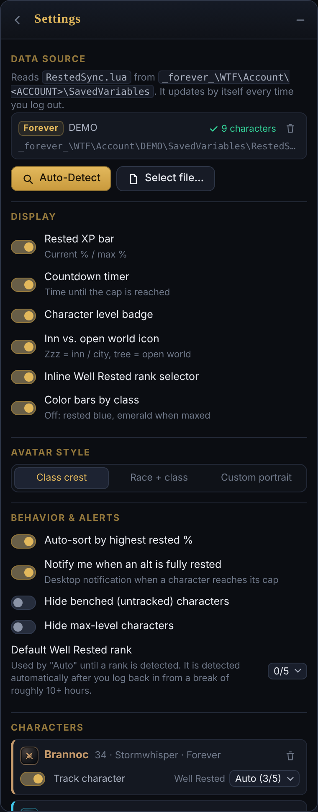

# WoW Rested Tracker + RestedSync addon

A free, open-source **system-tray widget** that shows how much **rested XP** each of your
World of Warcraft alts has built up while you weren't playing them. It's built for
**WoW Forever** (including the *Well Rested* Legacy perk) and also works with Classic Era,
Anniversary and Retail.

* **Automatic.** The tiny **RestedSync** addon records each character's rested XP, level and
  whether it logged out in an inn. The widget picks that up the moment you log out. You
  never type anything in by hand.
* **Inn or open world is detected for you.** The addon reads `IsResting()` (the *Zzz*
  state) at logout, so characters parked in an inn or capital city build rested XP at the
  full rate, and characters logged out in the field build it at ¼ speed.
* **Well Rested perk detected for you.** After a character logs back in from a break of
  roughly 10+ hours, the widget measures how fast its rested XP actually grew and works out
  its Well Rested rank (0–5). You can still set the rank by hand.
* Lives in the tray, can start with Windows/macOS (off until you turn it on), sends a
  notification when an alt is fully rested, and keeps itself up to date with signed
  updates. No ads, no account, no telemetry.

| Expanded | Compact | Settings |
| :---: | :---: | :---: |
|  |  |  |

> Characters you have never logged into don't appear. They have no rested XP to track
> anyway. Log into an alt once with the addon enabled and it shows up from then on.

---

## How it works

```
 World of Warcraft                     your PC                         widget
┌────────────────────┐  logout/exit   ┌─────────────────────────────┐  file watcher  ┌───────────────┐
│ RestedSync addon   │ ─────────────▶ │ WTF\Account\<ACCOUNT>\      │ ─────────────▶ │ tray widget   │
│ (records rested XP,│  (game writes  │   SavedVariables\           │  (instant,     │ computes the  │
│  level, Zzz state) │   the file)    │   RestedSync.lua            │   read-only)   │ offline gain  │
└────────────────────┘                └─────────────────────────────┘                └───────────────┘
```

WoW only lets addons save data when you **log out, exit the game or `/reload`**. The widget
watches that file and, between logins, calculates the rested XP each character keeps
gaining offline.

---

## 1. Install the addon

1. Copy the `addon/RestedSync` folder (or unzip `RestedSync-1.0.0.zip`) into your game's
   AddOns folder:

   | Game | Folder |
   | --- | --- |
   | **WoW Forever** | `C:\Program Files (x86)\World of Warcraft\_forever_\Interface\AddOns\` |
   | Classic Era / Hardcore | `...\World of Warcraft\_classic_era_\Interface\AddOns\` |
   | Anniversary / Classic | `...\World of Warcraft\_anniversary_\` or `_classic_\Interface\AddOns\` |
   | Retail | `...\World of Warcraft\_retail_\Interface\AddOns\` |

   On macOS it's `/Applications/World of Warcraft/_forever_/Interface/AddOns/`.
   You should end up with `...\AddOns\RestedSync\RestedSync.toc`.
2. On the character-select screen click **AddOns** and make sure **RestedSync** is ticked.
   If it says *Out of date*, tick **Load out of date AddOns** (see [Troubleshooting](#troubleshooting)).
3. Log into each alt once and log out, ideally **in an inn or a capital city** so it
   gains rested XP at the full rate.

The addon has no window, no slash commands and no settings. It only uses standard Blizzard
API calls (`GetXPExhaustion`, `UnitXPMax`, `IsResting`, ...).

## 2. Install the widget

**Option A: download a release.** Get the latest installer from the repository's
**Releases** page: the `.exe` for Windows, the `.dmg` for macOS. Each release lists
SHA-256 checksums in `SHA256SUMS.txt` (see [SECURITY.md](SECURITY.md)).

Test builds: every push also builds a Windows installer on GitHub Actions (**Actions** tab →
latest **Build** run → **Artifacts** → `installer-windows`).

> **"Windows protected your PC".** The app isn't code-signed yet, so Windows SmartScreen
> warns about it: click **More info → Run anyway**. On macOS, right-click the app →
> **Open** (or *System Settings → Privacy & Security → Open Anyway*). See
> [Code signing](#code-signing) for how to remove these warnings.

**Option B: build it yourself.** See [Development](#development).

## 3. Point the widget at RestedSync.lua

On first launch the widget looks for World of Warcraft automatically (registry entry, then
`Program Files`, `Games` and drive roots on all fixed drives) and starts watching every
`RestedSync.lua` it finds. If it can't find your install:

* **Settings → Select file…** and pick
  `World of Warcraft\_forever_\WTF\Account\<ACCOUNT>\SavedVariables\RestedSync.lua`, or
* **Settings → WoW folder…** and pick the `World of Warcraft` folder. Every client and
  account under it is listed and you click **Watch** on the ones you want.

`<ACCOUNT>` is a folder like `123456789#1` or `WOW1`. If you have several game accounts or
play several clients, you can watch several files at once.

---

## Using the widget

* **Left-click the tray icon** to show or hide the widget (bottom-right corner, above the
  taskbar). **Right-click** for *Show / Hide Widget, Force Sync Now, Settings, Support on
  Patreon, Quit*.
* **Pin** (📌) keeps it on top of other windows. Unpinned, it hides when you click away,
  like a tray flyout.
* **Compact view** (☰) switches to slim one-line rows.
* **⋯** on a card jumps to that character's settings: *Track character* (bench an alt
  without deleting it), *Well Rested* rank, portrait, *Remove*.
* The tray tooltip reads e.g. `WoW Rested Tracker — 3/9 Alts Maxed`.
* **Start with Windows/macOS** is off by default. Once your characters show up, the widget
  asks you once whether to turn it on. You can change it later in Settings.
* **Updates** install themselves while the widget is hidden in the tray (toggle in
  Settings → Updates, plus a *Check now* button). Every update is signed, and the app
  refuses anything that doesn't carry a valid signature.

### Settings

| Section | Options |
| --- | --- |
| Data source | Watched files with status, Auto-Detect, Select file…, WoW folder… |
| Display | Rested XP bar · countdown timer · level badge · Inn/World icon · inline Well Rested selector · color bars by class (off: rested blue → emerald when maxed) |
| Avatar style | Class crest · Race + class badge · Custom portrait (URL or image file, falls back to the class crest) |
| Behavior & alerts | Auto-sort by highest rested % · notify when an alt is fully rested · start with Windows/macOS (off by default) · hide benched characters · hide max-level characters · default Well Rested rank |
| Updates | Install updates automatically (on by default) · current version · Check now |
| Characters | Per character: track toggle, Well Rested rank, portrait, remove |

---

## Rested XP rules used

| | Inn / capital city (*Zzz*) | Open world |
| --- | --- | --- |
| Base rate | 5% of a level per 8 h (0.625%/h) | 1.25% per 8 h (0.15625%/h) |
| Base cap | 150% of the current level | 150% |
| Time from 0 to full | 10 days | 40 days |

**Well Rested** (WoW Forever Legacy perk, Adventure tree) adds **+4% per rank** to both the
rate and the cap:

| Rank | Multiplier | Cap | Inn rate | World rate |
| :---: | :---: | :---: | :---: | :---: |
| 0 | 1.00× | 150% | 0.6250%/h | 0.15625%/h |
| 1 | 1.04× | 156% | 0.6500%/h | 0.16250%/h |
| 2 | 1.08× | 162% | 0.6750%/h | 0.16875%/h |
| 3 | 1.12× | 168% | 0.7000%/h | 0.17500%/h |
| 4 | 1.16× | 174% | 0.7250%/h | 0.18125%/h |
| 5 | 1.20× | 180% | 0.7500%/h | 0.18750%/h |

```ts
multiplier = 1 + rank * 0.04
cap        = 150 * multiplier
rate       = (isResting ? 5 / 8 : 1.25 / 8) * multiplier          // % of a level per hour
current    = min(cap, savedPct + hoursSinceLogout * rate)
```

**Automatic rank detection.** On each real login the addon stores the rested XP from your
previous logout next to the rested XP right after logging in. The widget compares the
observed gain with what each rank (0–5) predicts. It only accepts a rank when exactly one
fits within 0.2 percentage points, which needs about 10 hours offline in an inn (or ~40 h
in the open world). If nothing fits, nothing is guessed. That also works as a check that the
rates above match the live game. Pick a rank manually in the dropdown to override it.

> The WoW Forever numbers above come from community guides (Warcraft Tavern and others)
> and could change with patches. All constants live in `src/math.ts`.

---

## Development

### Prerequisites

* **Node.js 22+** and **Rust** (stable, via <https://rustup.rs>)
* **Windows:** Microsoft C++ Build Tools ("Desktop development with C++") and WebView2
  (already included in Windows 10/11)
* **macOS:** Xcode Command Line Tools (`xcode-select --install`)
* **Linux:** `libwebkit2gtk-4.1-dev libayatana-appindicator3-dev librsvg2-dev libxdo-dev libssl-dev build-essential`

Full list: <https://v2.tauri.app/start/prerequisites/>

### Commands

```bash
git clone https://github.com/AleksaCvele/WoW_RestedXP.git
cd WoW_RestedXP
git checkout ccr-d0cb1aad-i0pyy6   # until it's merged into main

npm install

npm run dev            # UI only, in your browser, with demo characters (http://localhost:1420)
npm run tauri dev      # the real desktop app with hot reload
npm test               # unit tests (parser, math, sync)
npm run typecheck
cd src-tauri && cargo test && cd ..   # Rust tests (WoW folder detection)

npm run tauri build    # release build + installers
npm run package:addon  # → release/RestedSync-<version>.zip
npm run version:set 1.1.0   # bump the app version everywhere
```

`.npmrc` sets `ignore-scripts=true`, so packages can't run install scripts on your machine.
The project doesn't need any.

`npm run tauri build` writes the installers to:

* Windows: `src-tauri/target/release/bundle/nsis/WoW Rested Tracker_1.0.0_x64-setup.exe` and `bundle/msi/*.msi`
* macOS: `src-tauri/target/release/bundle/dmg/*.dmg` (`npm run tauri build -- --target universal-apple-darwin` for Intel + Apple Silicon)

### Customizing

* **Patreon link:** set `PATREON_URL` in [`src/config.ts`](src/config.ts). It's used by the
  footer heart, the Settings drawer and the tray menu.
* **Update server:** `plugins.updater` in [`src-tauri/tauri.conf.json`](src-tauri/tauri.conf.json)
  (public key + `latest.json` URL on this repository's Releases).
* **Addon interface version:** `## Interface:` in
  [`addon/RestedSync/RestedSync.toc`](addon/RestedSync/RestedSync.toc). Type
  `/dump select(4, GetBuildInfo())` in-game to see your client's number.
* **Race artwork:** drop your own images into [`src/assets/races/`](src/assets/races/README.md).
* **Class icons:** `src/assets/classes/*.svg` (original artwork, colored with the official
  class colors from `src/wow.ts`).

### Project layout

```text
addon/RestedSync/          WoW addon (.toc + .lua)
src/                       Widget UI (TypeScript, no framework)
  main.ts                  controller: sync, tray events, notifications, layout
  view.ts                  HTML rendering (cards, compact rows, settings drawer)
  math.ts                  rested XP + Well Rested math and rank detection
  luaParser.ts             safe SavedVariables parser (never evaluates code)
  sync.ts                  file → roster merge (keeps your per-character settings)
  platform.ts              Tauri bridge (+ browser demo mode)
  types.ts, wow.ts, icons.ts, config.ts, styles.css, assets/
src-tauri/                 Rust backend (Tauri v2)
  src/main.rs              app setup, plugins, commands
  src/tray.rs              tray icon, tooltip, menu
  src/widget.rs            bottom-right anchoring, pin, hide-on-blur
  src/watcher.rs           SavedVariables file watcher (notify + fallback poll)
  src/detect.rs            WoW folder auto-detection
  src/files.rs             state, allow-list of readable files, native file pickers
tests/                     Vitest tests + a Lua harness that runs the real addon
scripts/                   addon zip, version bump, CI build + release helpers
.github/workflows/         build.yml (tests, installers, draft releases), security.yml (audits)
.github/dependabot.yml     weekly dependency update PRs
SECURITY.md                official downloads, what the app accesses, how to report issues
```

---

## Releasing a new version (and auto-update)

One-time setup (the update-signing key):

1. GitHub → repository **Settings → Secrets and variables → Actions → New repository secret**:
   * `TAURI_SIGNING_PRIVATE_KEY`: the contents of the private key file
   * `TAURI_SIGNING_PRIVATE_KEY_PASSWORD`: its password
2. Keep a backup of both in a password manager. If the key is lost, installed copies can't
   auto-update to new releases any more (people would have to reinstall by hand).
   To make a new key: `npx tauri signer generate -w ~/.tauri/rested-tracker.key`, then put
   the new `.pub` contents into `plugins.updater.pubkey` in `src-tauri/tauri.conf.json`.
3. The repository must be **public**: the app downloads `latest.json` and the installers
   from the Releases page without logging in.

Each release:

```bash
npm run version:set 1.1.0
git commit -am "Release 1.1.0"
git tag v1.1.0
git push origin main v1.1.0
```

CI builds Windows + macOS, signs the update files and creates a **draft** release with the
installers, `latest.json` and `SHA256SUMS.txt`. Check the draft, then click **Publish**.
Installed copies pick it up within about 6 hours.

## Security

See [SECURITY.md](SECURITY.md) for official download locations, what the app can access and
how to report a vulnerability. In short:

* The addon runs in WoW's sandbox. It has no network or file access.
* The widget can only read files you picked or that auto-detection found. That allow-list
  is kept by the Rust backend, not the web UI. Everything read from save files is
  HTML-escaped, and a strict Content-Security-Policy is applied.
* Updates are signature-checked. The signing key is only given to tag builds in CI.
* CI uses only GitHub's own actions, with a read-only token except when creating a release.
  Lockfiles are enforced, dependency install scripts are disabled, Dependabot proposes
  updates weekly, and the *Security audit* workflow checks npm and Rust dependencies
  against known vulnerabilities.

Recommended GitHub settings: two-factor authentication on your account; **Settings →
Actions → General → Allow actions created by GitHub** only; **Settings → Code security →**
enable Dependabot alerts, secret scanning and private vulnerability reporting; and a
branch protection rule on `main`.

### Code signing

Unsigned Windows apps trigger SmartScreen's "Windows protected your PC" until the file
builds up reputation, and each new version starts from scratch. Options:

* **SignPath Foundation**: free code signing for open-source projects (the publisher shown
  is "SignPath Foundation"; the repository must be public and the project must apply).
* **Certum Open Source Code Signing**: an inexpensive certificate in your own name for open-source
  developers.
* Even with a certificate, SmartScreen can still warn for brand-new files until they
  build up reputation.

macOS: Gatekeeper blocks un-notarized apps unless you have an Apple Developer account
(paid, yearly) to sign and notarize them.

---

## Troubleshooting

**A character doesn't update.** The game only writes SavedVariables on logout, exit or
`/reload`. If WoW crashes, that session's data is lost. Log the character in and out again.

**"Out of date" addon.** The `.toc` lists several interface versions (WoW Forever `16001`,
Classic Era, Anniversary, Retail). If a patch bumps the number, tick *Load out of date
AddOns* or edit `## Interface:`.

**No notification.** On Windows, check *Settings → System → Notifications* and Focus/Do Not
Disturb. Notifications fire once per character per logout snapshot.

**Widget doesn't start with Windows.** It's off by default: turn on *Settings → Start with
Windows*. Also check *Task Manager → Startup apps*; the widget follows whatever Windows says.

**"No published update found".** Auto-update needs a public repository with a *published*
(not draft) release whose `latest.json` was signed. See
[Releasing a new version](#releasing-a-new-version-and-auto-update).

**A portrait from a file doesn't show.** Use the folder button next to the portrait field.
For safety the widget only reads images you picked through that dialog. Web links must
start with `https://`.

**Where are my settings stored?** `%APPDATA%\com.restedsync.tracker\state.json` on Windows,
`~/Library/Application Support/com.restedsync.tracker/` on macOS.

---

## Privacy & policy

The widget has no telemetry and no accounts. It only goes online to check this
repository's Releases for signed updates (can be turned off), to open links you click,
and to load portrait links you entered. It only reads the files you point it at.

The addon contains no URLs, ads, donation requests or monetization, and only uses standard
Blizzard API functions, in line with Blizzard's UI Add-On Development Policy. (The policy
forbids asking for donations *in the game*. The optional Patreon link lives only in the
desktop app and on the project page.)

World of Warcraft and Blizzard Entertainment are trademarks of Blizzard Entertainment, Inc.
This project is not affiliated with or endorsed by Blizzard Entertainment. All artwork in
this repository is original.

## License

[MIT](LICENSE)
